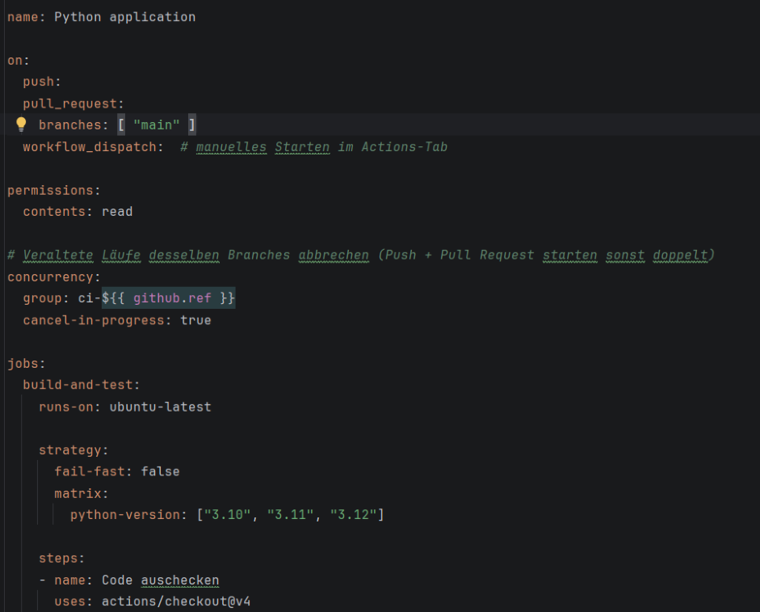
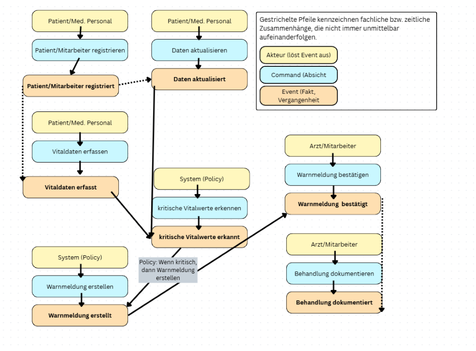
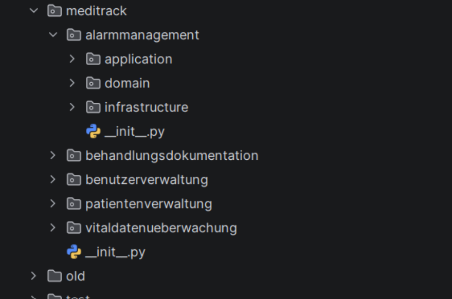
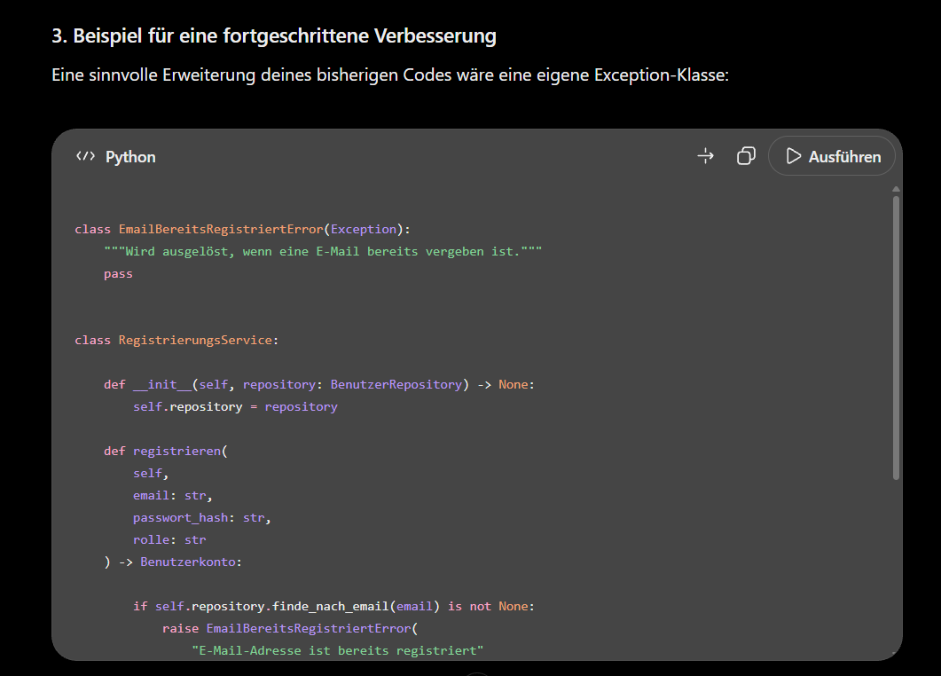
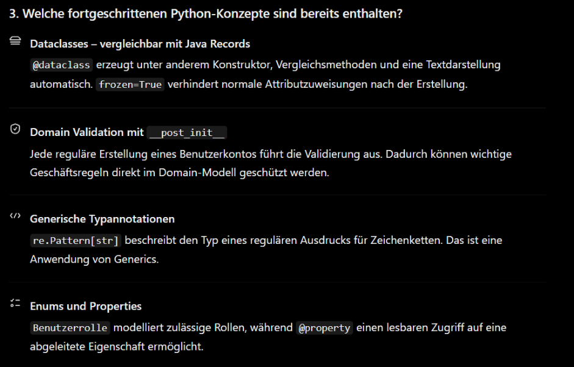
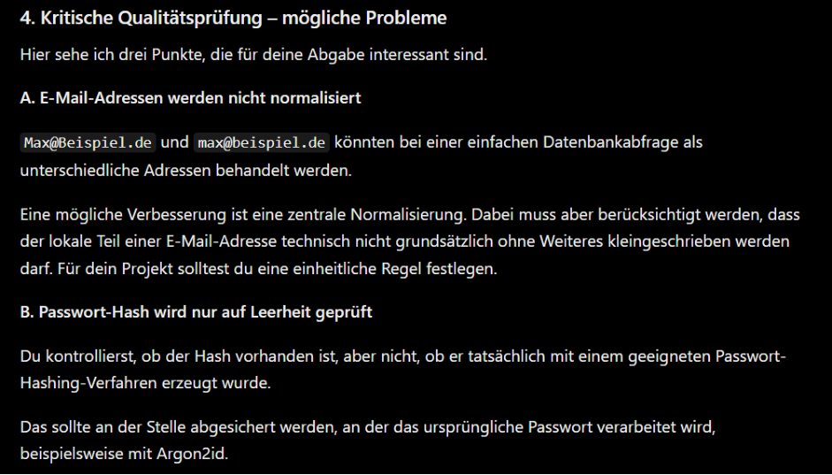
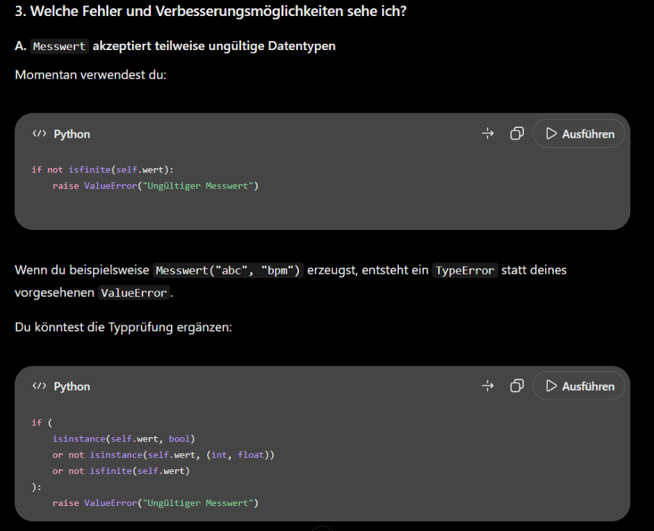
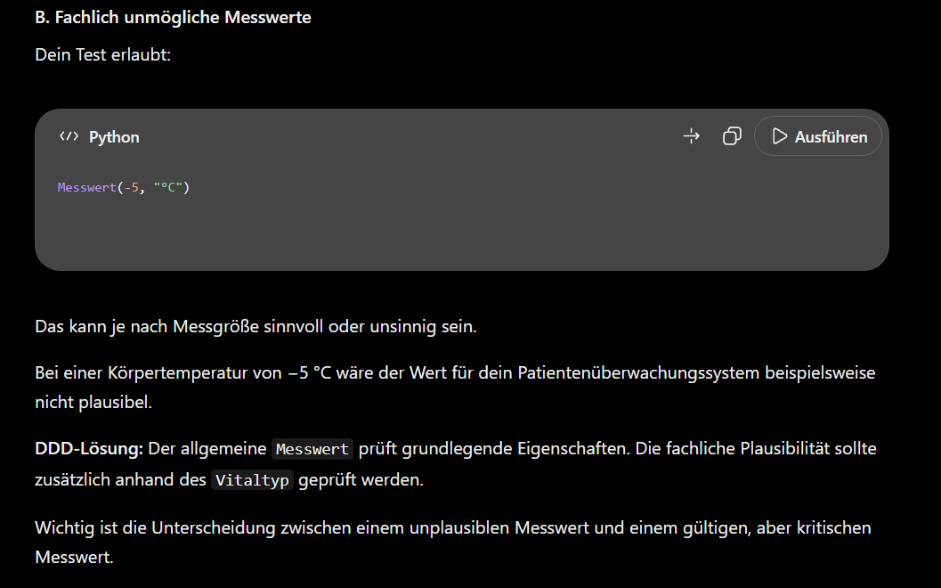
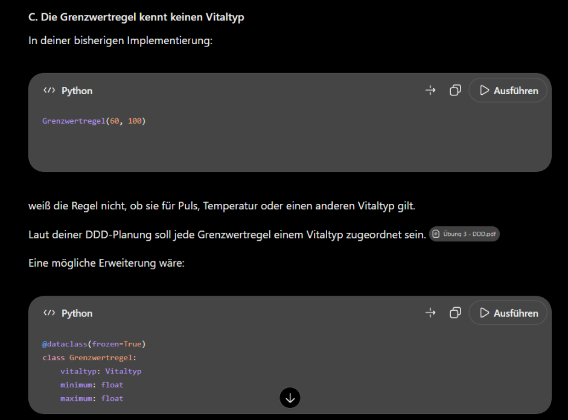

## **Moderne Softwareentwicklung** 

# **Dokumentation** 

Fabian Scholl (403416) Dennis Schmelzer (70464200) Marei Wiesehan (7028949) 

15. November 2026 

### **1. Einführung und Kontext** 

#### **1.1 Problemstellung und Projektmotivation** 

Im Krankenhaus oder in der Arztpraxis muss das Personal die Vitalwerte vieler Patienten gleichzeitig im Blick behalten, und ein übersehener kritischer Wert kann gefährlich werden. MediTrack soll diese Werte erfassen, automatisch mit Grenzwerten vergleichen und bei Auffälligkeiten Alarm schlagen. Wir haben das Thema gewählt, weil die fachlichen Regeln, etwa Grenzwerte und Warnmeldungen, klar sind und sich gut mit Domain-Driven Design umsetzen lassen. 

#### **1.2 Zielsetzung** 

Am Ende soll eine Anwendung stehen, mit der man Patienten und Benutzer anlegen, Vitalwerte erfassen und prüfen, Warnmeldungen bestätigen und Behandlungen dokumentieren kann. Außerdem soll der Code sauber aufgebaut sein: Er ist in fünf fachliche Bereiche aufgeteilt, wird automatisch getestet und bei jeder Änderung über eine CI-Pipeline geprüft. Eine Weboberfläche folgt mit Übungsblatt 5. 

#### **1.3 Technologie-Stack** 

Für die Entwicklung des Projekts wurden folgende Technologien und Werkzeuge eingesetzt: 

- **Programmiersprache:** Python 3.12 (in der CI zusätzlich 3.10 und 3.11) 

- **Backend:** FastAPI; die eigentliche Fachlogik ist reines Python 

- **Frontend:** noch keine eigene Oberfläche (folgt mit Übungsblatt 5), bisher nur eine einfache Testseite aus HTML und JavaScript 

- **Datenbank:** SQLite für die Web-Schnittstelle; die Fachdaten liegen bisher nur im Arbeitsspeicher 

- **Versionsverwaltung:** Git und GitHub 

- **CI/CD:** GitHub Actions 

- **Testing:** pytest, dazu pytest-cov für die Testabdeckung 

- **Weitere Tools:** PyCharm, flake8 zur Code-Prüfung und Claude Code als KI-Assistent 

### **2. Chronologische Projektentwicklung** 

#### **2.1 Repository-Setup und Grundlagen** 

Zu Beginn des Projekts wurde ein Git-Repository eingerichtet, um eine strukturierte Versionsverwaltung und gemeinsame Entwicklung zu ermöglichen. 

**Repository-Link:** https://github.com/DennisS4207/MediTrack 

Dennis hat das Repository auf GitHub angelegt, und als Erstes haben wir gemeinsam eine README mit den Git-Grundlagen geschrieben. Jeder von uns arbeitet auf einem eigenen 

Branch. Fertige Änderungen kommen über einen Pull Request in den main-Branch; laut unserer README schaut vorher jemand anderes aus dem Team darüber. Den Code haben wir von Anfang an nach fachlichen Bereichen aufgeteilt, zum Beispiel Patientenverwaltung oder Alarmmanagement. Jeder Bereich hat dieselben drei Ebenen: die Fachlogik (domain), die Abläufe (application) und die Technik (infrastructure). Die Tests liegen getrennt im Ordner “test”. 

#### **2.2 CI/CD-Implementierung** 

Im weiteren Projektverlauf wurde eine Continuous-Integration-Pipeline eingerichtet, um wichtige Entwicklungsprozesse zu automatisieren. 

##### **Pipeline-Aufbau:** 

Die Pipeline läuft in GitHub Actions und zwar gleichzeitig mit drei Python-Versionen (3.10, 3.11 und 3.12). Zuerst holt sie den Code und installiert alle Abhängigkeiten. Dann prüft flake8 den Code auf Fehler und einheitlichen Stil. Danach laufen die Architektur-Tests, die kontrollieren, ob die Bereiche sauber getrennt sind, und zum Schluss alle übrigen Tests. Fällt die Testabdeckung unter 90 Prozent, schlägt der Lauf fehl. Die Ergebnisse werden als Bericht gespeichert. 

##### **Automatisierungsprozesse:** 

Die Pipeline startet automatisch bei jedem Push, egal auf welchem Branch, und bei jedem Pull Request auf “main”. Man kann sie auch von Hand anstoßen. Für uns heißt das: Niemand muss daran denken, die Tests selbst laufen zu lassen, und Fehler fallen auf, bevor sie in “main” landen. Anfangs lief die Pipeline nur für “main”; in Übung 4 haben wir sie auf alle Branches erweitert. 

**Screenshot:** .github/workflows/python-app.yml 

#### **2.3 Domain-Modellierung und Event-Struktur** 

Für die fachliche Modellierung des Projekts wurden zunächst relevante Domain Events identifiziert und hinsichtlich ihrer Bedeutung für die Anwendung priorisiert. 

##### **Identifizierte und priorisierte Domain Events:** 

1. **Patient/Mitarbeiter registriert:** Ein Patient oder jemand vom medizinischen Personal wird im System registriert. 

2. **Daten aktualisiert:** Bereits gespeicherte Daten werden von Patient oder Personal geändert. 

3. **Vitaldaten erfasst:** Ein Vitalwert wird für einen Patienten erfasst. Das ist der Auslöser für die Prüfung gegen die Grenzwerte. 

4. **Kritische Vitalwerte erkannt:** Das System prüft die erfassten Werte automatisch und erkennt, wenn sie außerhalb der Grenzwerte liegen. 

5. **Warnmeldung erstellt:** Nach der Regel „Wenn kritisch, dann Warnmeldung erstellen“ erzeugt das System automatisch eine Warnmeldung. 

6. **Warnmeldung bestätigt:** Ein Arzt oder Mitarbeiter bestätigt die Warnmeldung. 

7. **Behandlung dokumentiert:** Ein Arzt oder Mitarbeiter hält die durchgeführte Behandlung fest. 

##### **Domain-Driven Design (DDD):** 

Wir haben die Anwendung in fünf fachliche Bereiche aufgeteilt, die im Domain-Driven Design Bounded Contexts heißen. Jeder Bereich kümmert sich um genau ein Thema und greift nicht direkt auf die anderen zu. Verbunden sind sie nur über IDs, etwa die Patienten-ID: 

- **Benutzerverwaltung:** Benutzerkonten mit E-Mail, Passwort-Hash und Rolle (Patient oder Mitarbeiter). 

- **Patientenverwaltung:** die Stammdaten der Patienten, also Name und Geburtsdatum. 

- **Vitaldatenüberwachung:** Messungen mit Wert, Einheit und Art der Messung sowie die Grenzwerte, gegen die geprüft wird. 

- **Alarmmanagement:** Warnmeldungen mit gemessenem Wert, Grenzwert, Schweregrad und der Info, ob sie schon bestätigt wurden. 

- **Behandlungsdokumentation:** durchgeführte Maßnahmen mit Zeitpunkt und Notiz. 

In jedem Bereich gibt es ein zentrales Objekt, über das alles läuft, etwa den Patienten oder die Warnmeldung. Im DDD-Jargon heißt das Aggregate Root. Kleine, unveränderliche Bausteine wie ein Messwert mit Einheit sind Value Objects; sie prüfen schon beim Anlegen, ob ihre Werte sinnvoll sind. Gespeichert wird über sogenannte Repositories, und die Abläufe stecken in Services wie dem PatientenService. 

**Visualisierung:** 

### **3. Projektimplementierung** 

#### **3.1 Projektstruktur** 

Die Implementierung erfolgte auf Grundlage einer strukturierten Projektarchitektur, um die einzelnen Komponenten möglichst übersichtlich und wartbar zu gestalten. 

Der gesamte Code liegt im Ordner meditrack. Darin hat jeder fachliche Bereich einen eigenen Unterordner, und alle sind gleich aufgebaut: 

- **domain:** die Fachlogik, also die Objekte und ihre Regeln, ganz ohne Technik. 

- **application:** die Abläufe, zum Beispiel „Patient anlegen“ oder „Warnmeldung bestätigen“. 

- **infrastructure:** die technische Umsetzung, im Moment eine Speicherung im Arbeitsspeicher. 

- **test:** alle Tests, pro Bereich eine Datei, plus ein Test, der die Architektur prüft. 

- **main.py und index.html:** eine erste Web-Schnittstelle und eine einfache Testseite. 

- **.github/workflows:** die CI-Pipeline. 

- **Dokumentation:** unsere Texte zu den Übungen. 

**Screenshot:** 

#### **3.2 Teststrategie und Test-Driven Development** 

Während der Entwicklung wurde teilweise ein Test-Driven-Development-Ansatz (TDD) verfolgt. 

Bei der Fachlogik haben wir möglichst zuerst die Tests geschrieben und erst danach den Code. Die Tests waren also zunächst rot und wurden dann grün. Am konsequentesten hat das bei Alarmmanagement und Behandlungsdokumentation geklappt. Bei den ersten Bereichen kamen Tests und Code im selben Commit ins Repository; dort lässt sich also nicht belegen, dass die Tests zuerst da waren. Deshalb sprechen wir von teilweisem TDD. Getestet werden die einzelnen Objekte, die Abläufe in den Services (mit einem Speicher im Arbeitsspeicher statt einer Datenbank) und die Architektur. Ein Großteil der Tests prüft die Eingaben; dort lagen auch alle Fehler, die die Tests aufgedeckt haben. 

##### **Testabdeckung kritischer Komponenten:** 

Wir haben bewusst auch ungewöhnliche Eingaben getestet: E-Mail-Adressen mit Leerzeichen oder doppeltem @, ein Geburtsdatum in der Zukunft, Messwerte wie „unendlich“ oder riesige Zahlen und Werte genau auf der Grenze. Insgesamt sind es 238 Tests, die knapp 98 Prozent des Codes abdecken; die Pipeline verlangt mindestens 90 Prozent. Die Web-Schnittstelle in main.py wird bisher noch nicht getestet. 

#### **3.3 Backend-Architektur** 

Das Backend bildet die Grundlage für die Verarbeitung der Geschäftslogik und die Verwaltung der benötigten Daten. 

Das Herzstück sind die Services in den einzelnen Bereichen. Der RegistrierungsService legt Benutzerkonten an und passt auf, dass keine E-Mail doppelt vergeben wird. Der PatientenService legt Patienten an und findet sie wieder. Der AlarmService erzeugt Warnmeldungen, lässt sie bestätigen und zeigt die noch offenen an. Der BehandlungsService hält Behandlungen fest und liefert den Verlauf eines Patienten. Für die Vitaldaten gibt es bisher nur das Modell, aber noch keinen eigenen Service. Daneben gibt es in main.py eine kleine FastAPI-Anwendung, die aber noch nicht mit der Fachlogik verbunden ist. 

##### **Datenmodell und Persistenz:** 

Die Fachdaten liegen bisher nur im Arbeitsspeicher und sind nach einem Neustart weg. Nur die Web-Schnittstelle schreibt schon in eine SQLite-Datenbank. Eine richtige Datenbank für alle Daten ist der nächste Schritt. Dank der klaren Trennung müssen wir dafür nur den Technik-Teil austauschen und nicht die Fachlogik. 

#### **3.4 Benutzeroberfläche und UI/UX** 

Eine richtige Benutzeroberfläche gibt es zum Zeitpunkt dieser Dokumentation noch nicht. Die Frontend-Entwicklung ist Teil von Übungsblatt 5, das wir noch nicht bearbeitet haben. Bisher existiert nur eine einfache Testseite, mit der wir ausprobiert haben, ob Browser, FastAPI und Datenbank zusammenspielen. Da wir weiter am Projekt arbeiten, kann sich dieser Stand nach Abgabe des Dokuments bereits geändert haben. 

##### **Nutzerinteraktionsfluss:** 

Für die geplante Oberfläche steht der Ablauf noch nicht fest. Auf der Testseite startet man den Server mit „uvicorn main:app --reload“, öffnet http://127.0.0.1:8000/ui, gibt einen Text ein und speichert ihn. Der Eintrag erscheint danach direkt in der Liste darunter. 

**Screenshots:** Noch keine, da die eigentliche Oberfläche erst mit Übungsblatt 5 entsteht. 

##### **Technische Besonderheiten:** 

Die Testseite ist eine einzelne HTML-Datei mit etwas JavaScript, ohne Framework. Sie zeigt aber schon, wie die spätere Oberfläche mit dem Backend sprechen kann: über die Schnittstellen von FastAPI, die unter /docs automatisch dokumentiert sind. 

##### **Optimierungen:** 

Für die richtige Oberfläche nehmen wir aus der Testseite einiges mit: Eingaben müssen vor der Anzeige gefiltert werden (Schutz vor XSS), Fehler vom Server sollen sauber angezeigt werden, und die Seite soll die eigentliche Fachlogik nutzen, also Patienten, Vitalwerte und Warnmeldungen. 

### **4. LLM-Integration** 

**4.1 Einsatzbereiche von Large Language Models** 

Im Rahmen der Projektentwicklung wurden Large Language Models (LLMs) zur Unterstützung verschiedener Entwicklungsaufgaben eingesetzt. 

Eingesetzt haben wir Claude Code direkt in PyCharm und zusätzlich ein chatbasiertes LLM im Browser, aus dem die Screenshots oben stammen. Auch für das Review unserer Strategie in Übung 4.1 haben wir ein LLM um Feedback gebeten. 

##### **Konkrete Einsatzbereiche:** 

- Code schreiben: das Grundgerüst für Alarmmanagement und Behandlungsdokumentation 

- Tests: Ideen für normale Fälle, Fehlerfälle und Grenzfälle, die wir dann geprüft und angepasst haben 

- Fehlersuche: herausfinden, warum drei Tests plötzlich fehlschlugen 

- Aufräumen: doppelten Code zusammenfassen, Importe ordnen, Konfiguration korrigieren 

- Sonstiges: Feedback zur Architektur, die Erweiterung der Pipeline und Entwürfe für Dokumentationstexte 

- Code-Analyse im Chat: Hinweise auf Schwachstellen im bestehenden Code, zum Beispiel die fehlende Typprüfung beim Messwert (siehe Screenshots) 

#### **4.2 Konkrete Beispiele und Mehrwert** 

Ein gutes Beispiel waren die Grenzfälle. Das LLM schlug Tests mit ungewöhnlichen Eingaben vor, etwa ein Geburtsdatum mit Uhrzeit oder eine riesige Zahl als Messwert. Dabei fielen drei echte Fehler auf, die bis dahin unbemerkt geblieben waren. Auch die Idee, die Trennung der Bereiche mit einem eigenen Test automatisch zu prüfen, kam vom LLM. 

Die Screenshots oben zeigen eine Analyse unseres Codes durch das Chat-LLM. Einige der Hinweise sind heute im Code umgesetzt, nämlich die Typprüfung beim Messwert und der Vergleich von E-Mail-Adressen ohne Beachtung der Groß- und Kleinschreibung. Nicht umgesetzt sind bisher eine eigene Exception-Klasse für bereits registrierte E-Mails, die Absicherung des Passwort-Hashings (vorgeschlagen war Argon2id), die Zuordnung einer Grenzwertregel zu einem Vitaltyp und eine fachliche Plausibilitätsprüfung je Vitaltyp. 

Übernommen haben wir nichts ungeprüft: Jeder Vorschlag wurde gelesen und lokal ausgeführt. Dabei wurde auch klar, wo die Grenzen liegen. Das LLM hat zum Beispiel eine Regel eingebaut, die fachlich gar nicht abgesprochen war (Patient und Mitarbeiter dürfen nicht dieselbe ID haben). So etwas muss man erkennen und im Team entscheiden, das kann einem die KI nicht abnehmen. 

### **5. Technische Herausforderungen** 

#### **5.1 Herausforderung 1: Fehlschlagende Tests nach der Umstellung der Rollen** 

**Problem:** 

Wir hatten die Benutzerrolle von einfachem Text auf eine feste Auswahl (ein Enum) umgestellt. Danach schlugen auf einmal drei Tests fehl, weil an manchen Stellen die Rolle noch als Text übergeben wurde. 

##### **Lösungsansatz:** 

Statt alle Aufrufe zu ändern, wandelt das Benutzerkonto den Text jetzt selbst in die passende Rolle um. Ungültige Rollen wie „ADMIN“ werden weiterhin abgelehnt. So bleibt die Bedienung einfach und trotzdem sicher. 

#### **5.2 Herausforderung 2: Falsche Fehlermeldungen bei ungewöhnlichen Eingaben** 

##### **Problem:** 

Bei manchen Eingaben brach der Code mit dem falschen Fehler ab. Ein Geburtsdatum mit Uhrzeit, eine riesige Zahl oder eine fehlende Einheit führten zu technischen Fehlern statt zu einer verständlichen Meldung. Außerdem wurde „True“ als Messwert akzeptiert. 

##### **Lösungsansatz:** 

Wir prüfen jetzt zuerst, ob überhaupt der richtige Datentyp ankommt, und erst danach den Wert. Für Zahlen gibt es dafür eine kleine Hilfsfunktion. Die steht absichtlich in jedem Bereich einzeln, damit die Bereiche unabhängig voneinander bleiben. 

### **6. Projektabschluss und Reflexion** 

#### **6.1 Erreichte Meilensteine** 

Im Verlauf der Projektarbeit konnten folgende wesentliche Meilensteine erreicht werden: 

- Git-Repository eingerichtet und im Team mit Branches und Pull Requests gearbeitet 

- CI-Pipeline mit GitHub Actions, die Code und Tests bei jeder Änderung prüft ● Fachlogik in fünf sauber getrennten Bereichen nach Domain-Driven Design umgesetzt 

- 238 automatische Tests, die knapp 98 Prozent des Codes abdecken 

- Erste Web-Schnittstelle mit FastAPI als Grundlage für die spätere Oberfläche 

#### **6.2 Umsetzung der priorisierten Domain Events** 

Die in Übung 3 per Event Storming identifizierten Events (siehe Diagramm in 2.3) sind im Code derzeit so umgesetzt: 

- **Patient/Mitarbeiter registriert:** umgesetzt. Patienten werden über den PatientenService angelegt, Benutzerkonten mit der Rolle Patient oder Mitarbeiter über den RegistrierungsService. 

- **Daten aktualisiert:** nicht umgesetzt. Es gibt noch keine Funktion zum Ändern gespeicherter Daten. 

- **Vitaldaten erfasst:** teilweise. Das Modell für eine Messung inklusive Prüfung der Eingaben existiert, aber noch kein Service und kein Repository zum Speichern. 

- **Kritische Vitalwerte erkannt:** teilweise. Die Grenzwertregel erkennt kritische Werte, wird nach dem Erfassen aber noch nicht automatisch aufgerufen. 

- **Warnmeldung erstellt:** teilweise. Der AlarmService kann Warnmeldungen erzeugen, allerdings nur auf direkten Aufruf und nicht automatisch nach einem kritischen Wert. 

- **Warnmeldung bestätigt:** umgesetzt über den AlarmService. 

- **Behandlung dokumentiert:** umgesetzt über den BehandlungsService, inklusive Verlauf pro Patient. 

Die Events selbst gibt es noch nicht als eigene Objekte im Code, und es fehlt ein Mechanismus, der sie zwischen den Bereichen weiterreicht. Deshalb fehlt vor allem die automatische Kette vom kritischen Messwert bis zur Warnmeldung. 

#### **6.3 Nicht erreichte Meilensteine** 

Im Review in Übung 4.1 hatten wir eine relationale Datenbank für alle Daten, Integrationstests mit einer echten Datenbank, Last- und Performance-Tests sowie die Trennung von Patienten und medizinischem Personal in eigene Modelle in Betracht gezogen. Davon ist noch nichts umgesetzt. Außerdem fehlen die automatische Warnmeldung bei kritischen Werten, das Aktualisieren von Daten und die eigentliche Benutzeroberfläche (Übungsblatt 5). 

#### **6.4 Technische Innovationen** 

Eine technische Besonderheit ist der Architekturtest. Er liest den Quellcode automatisch und meldet, sobald ein Bereich unerlaubt auf einen anderen zugreift. So kann die saubere Trennung nicht aus Versehen kaputtgehen. Außerdem prüfen unsere Fachobjekte ihre Daten schon beim Anlegen, sodass ungültige Daten gar nicht erst ins System kommen. Und die Pipeline schlägt Alarm, wenn die Testabdeckung zu stark sinkt. 

#### **6.5 Lessons Learned und persönliche Reflexion** 

Überrascht hat uns, wie viele Fehler erst durch gezielte Tests sichtbar wurden, Dinge, die im normalen Betrieb lange unbemerkt geblieben wären. Domain-Driven Design hat uns geholfen, Ordnung in den Code zu bringen. Gleichzeitig waren die DDD-Begriffe und die Frage, welche Regel in welchem Bereich gehört, nicht immer einfach. Schwierig waren außerdem die Absprache im Team und die Zeitplanung. Die KI hat uns viel Routinearbeit abgenommen, aber man muss jeden Vorschlag verstehen und prüfen. Blind übernehmen geht nicht. 

Bewährt haben sich kleine Schritte, die von Anfang an getestet werden, und eine Pipeline, die jede Änderung prüft. Beim nächsten Projekt würden wir die Verbindung zwischen den Bereichen und der Datenbank früher angehen und fachliche Regeln öfter gemeinsam im Team besprechen. 

